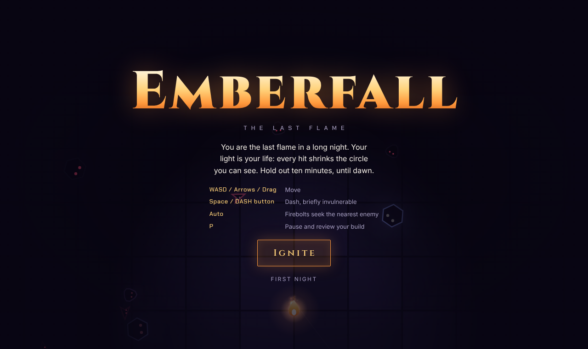
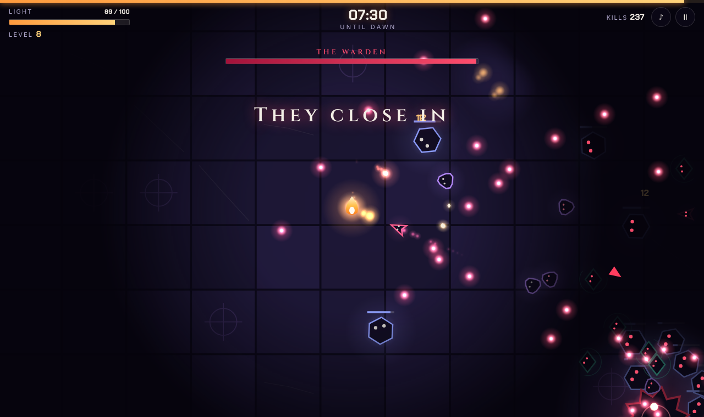

# Emberfall



A roguelite survival game that runs in the browser. You are the last flame in a long night. Your light is your life: every hit shrinks the circle you can see. Hold out ten minutes, until dawn.

Everything is a single `index.html` with no build step and no assets. Graphics, lighting, particles, sound effects and music are all generated in code (Canvas 2D and the Web Audio API).

## Play

Open `index.html` in any modern browser, or serve the folder:

```bash
python3 -m http.server 8000
```

Then visit `http://localhost:8000`.

To host it for free, enable GitHub Pages for this repository (Settings → Pages → deploy from the `main` branch, root folder).

## Controls

| Action | Keyboard | Touch |
| --- | --- | --- |
| Move | WASD or arrow keys | Drag anywhere |
| Dash (briefly invulnerable) | Space or Shift | DASH button |
| Pick an upgrade | 1 / 2 / 3 or click | Tap a card |
| Pause and review your build | P or Esc | Pause button |
| Mute | M | ♪ button |

Firebolts aim at the nearest enemy automatically.

## What's in it

- **Light as health.** A dynamic darkness layer is cut open by your flame, your projectiles and explosions. Enemies outside the light show only as glowing eyes.
- **14 upgrades**, each with several levels: bolt damage, fire rate, multishot, pierce, orbiting sprites, chain lightning, cinder bursts, homing embers, and utility powers such as speed, regeneration and a dash that leaves a burning trail.
- **5 enemy types** with distinct behavior (wanderers, chargers, brutes, casters, splitters), periodic encirclement waves, and a boss every two minutes.
- **Dawn at 10:00**, then an optional endless mode. Your longest run is saved in the browser.

## Visual style



The whole look follows from one idea: **you are the only warm thing on screen.** The flame and everything it creates is warm (orange, gold, cream). The night and everything in it is cold (violet, blue, teal) or hostile (red, pink). You can read the state of a fight from color temperature alone.

### Principles

1. **Light is the health bar.** There is a numeric bar in the corner, but the real indicator is how much of the floor you can see. Full light reaches about 405 world units; near death it shrinks to about 150.
2. **Darkness hides bodies, never threats.** Enemies outside the light lose their shape but keep a pair of red eyes. Enemy projectiles are drawn above the darkness at full brightness, so nothing that can hurt you is invisible.
3. **Glow, not outlines, carries energy.** Projectiles, particles and pickups are additive glow sprites. Enemies are the opposite: dark bodies with a thin colored stroke, so they read as holes in the light.
4. **Shape tells you behavior.** Every enemy type has its own silhouette, so you can tell them apart before you can see their color.

### Palette

| Token | Hex | Role |
| --- | --- | --- |
| `--night` | `#0d0a1a` | Background, the color of the dark |
| `--stone` | `#1b1632` | Floor tiles (with two lighter variants, `#1e1837` and `#221b3e`) |
| `--ember` | `#ff9a3d` | The player, primary accent, buttons |
| `--flame` | `#ffd27a` | Highlights, XP embers, key numbers |
| `--bone` | `#f3eee6` | Primary text |
| `--ash` | `#a9a1c4` | Secondary text and labels |
| `--blood` | `#ff4d6d` | Damage, enemy projectiles, boss UI |

Neutrals are tinted violet rather than grey so they sit in the same world as the night.

### Enemies

| Enemy | Shape | Color | Behavior the shape signals |
| --- | --- | --- | --- |
| Wisp | Wobbling blob | `#b98cff` | Drifts toward you in a weave |
| Dart | Arrowhead | `#ff5d8f` | Stops, flashes white, then charges in a straight line |
| Brute | Hexagon | `#8fa0ff` | Slow and heavy, shows a health bar once hit |
| Caster | Diamond with an orbiting arc | `#4fe3c1` | Keeps its distance and shoots |
| Splitter | Pulsing oval | `#a6e34f` | Bursts into three small ones |
| Warden (boss) | Rotating 10-point star | `#ff3d5e` | Bullet rings, fans and spirals |

### Typography

| Role | Typeface | Used for |
| --- | --- | --- |
| Display | Cinzel (600, 900) | Title, headings, buttons, event banners. Carved capitals suit a ruin at night. |
| Body | Inter | Descriptions and instructions |
| Numeric | Chakra Petch | Timer, stats, damage numbers. Tabular figures so digits do not jitter. |

Labels are small uppercase with wide letter spacing. Large type is reserved for the title, the timer and end-of-run stats.

### Interface

- **The HUD stays in the corners** and is deliberately quiet: light bar top left, countdown to dawn top center, controls top right, a thin XP line across the very top.
- **Upgrade cards** each take the color of their power, shown as a top border, a ringed monogram and level pips. The pip you are about to gain is white.
- **Overlays never fully hide the game.** Menus sit on a translucent veil so the scene stays visible behind them.

### Motion and feedback

- Hits flash the enemy white, throw sparks and show a damage number. Crits are larger and paler.
- Taking damage shakes the screen, flashes a red vignette and knocks nearby enemies back. Below 30% light the vignette pulses.
- Picking up embers plays a rising pitch that climbs with your streak.
- Screen shake and transitions are disabled when the system asks for reduced motion.

### Sound

All audio is synthesized live. Sound effects are short oscillator and filtered-noise bursts. The music is a small step sequencer in A minor pentatonic over a four-bar bass line. It speeds up and adds percussion as the night goes on, and gains a higher voice while a boss is alive.

## Code map

`index.html` is organized in commented sections:

| Section | Contents |
| --- | --- |
| Data | Enemy stats (`ET`) and the upgrade table (`UPS`) |
| Audio | Synthesized sound effects and the generative music sequencer |
| Enemies / Player | Spawning, damage, weapons |
| Update | The per-frame simulation, including difficulty scaling |
| Render | World drawing, the lighting pass, and screen overlays |

Tuning the game mostly means editing `ET`, `UPS`, `recalc()` (player stats) and the spawn-rate lines at the top of `update()`.
